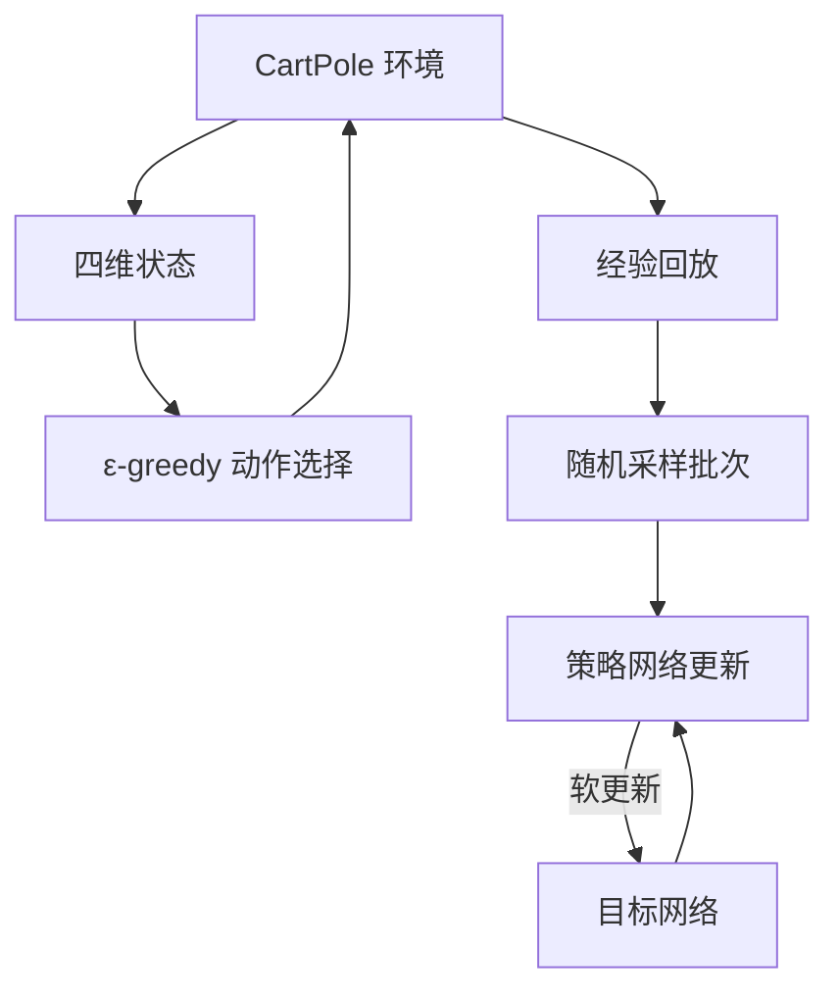

# Reinforcement Learning Lab · Gymnasium 与 DQN

[简体中文](README.md) | [English](README_EN.md)

从环境交互到价值学习的强化学习实验：通过 Gymnasium 理解状态、动作、奖励和 episode，再研究 PyTorch DQN 在 CartPole 控制任务中的训练流程。

**技术栈：** Python · Gymnasium · PyTorch · NumPy · Matplotlib · Jupyter

## 项目内容

- **环境交互**：在 CartPole 与 LunarLander 中执行随机策略，观察状态、奖励、终止和截断。
- **空间建模**：通过 `Discrete` 与 `Box` 理解离散动作空间和连续观测空间。
- **DQN 训练结构**：策略网络、目标网络、经验回放、ε-greedy 动作选择与目标值计算。
- **训练稳定性机制**：Huber loss、梯度裁剪与目标网络软更新。
- **实验分析**：记录 episode duration 与滑动平均，并保留网络结构、探索策略和奖励设计的实验代码与注释。

## CartPole DQN 流程



网络直接接收 CartPole 的四维观测，为两个离散动作输出 Q 值。回放缓冲区保存 `state / action / next_state / reward`，训练时随机抽样，并通过目标网络构造 Bellman 目标。

## 模型与训练配置

| 项目 | 配置 |
| --- | --- |
| 环境 | `CartPole-v1` |
| Q-network | 输入 → 128 → 128 → 动作数；ReLU |
| Replay memory | `deque`，容量 10,000 |
| Batch size | 128 |
| Discount factor | 0.99 |
| Optimiser | AdamW，`lr=1e-4`，`amsgrad=True` |
| Loss | SmoothL1Loss / Huber loss |
| Target update | 软更新，`TAU=0.005` |
| 探索率 | 自定义线性衰减，下限 0.05 |
| 设备 | CUDA 可用时使用 GPU，否则 CPU |
| 曲线 | Episode duration 与 100-episode 滑动平均 |

Notebook 同时保留了较宽网络、指数探索率与额外奖励惩罚等实验方案，可结合代码中的注释比较不同设计；这些方案与当前有效配置分别呈现。

## 文件导航

| 文件 | 内容 |
| --- | --- |
| `1.gym.ipynb` | Gymnasium 接口、随机策略、CartPole/LunarLander、空间示例 |
| `2.reinforcement_q_learning.ipynb` | PyTorch DQN、经验回放、模型、训练循环与可视化 |
| `3.mindspore_rl_dqn.ipynb` | DQN 迁移到 MindSpore 的拓展实验说明 |
| 根目录实验报告 | 实验记录与分析，提供 PDF / DOCX 版本 |
| `lab3-强化学习课件.pdf` | 课程强化学习材料 |

MindSpore 部分定位为拓展任务说明；DQN 的主要代码实现使用 PyTorch。

## 环境准备

使用独立 Python 环境，并安装与计算设备匹配的 PyTorch。基础 Notebook 与 CartPole 依赖：

```bash
git clone https://github.com/VincentLucifer/AI-Lab3-ReinforcementLearning.git
cd AI-Lab3-ReinforcementLearning
python -m pip install notebook ipykernel numpy matplotlib "gymnasium[classic-control]"
jupyter notebook
```

`1.gym.ipynb` 还包含 `LunarLander-v3`，该部分需额外准备 Box2D 依赖：

```bash
python -m pip install "gymnasium[box2d]"
```

Human 模式需要桌面显示环境；服务器使用时按需设置 `render_mode`。

## 阅读顺序

1. 阅读 `1.gym.ipynb`：理解 `reset()`、`step()`、状态与动作空间。
2. 阅读 `ReplayMemory` 和 `DQN`：建立数据流与 Q-network 的对应关系。
3. 跟踪 `select_action()`、`optimize_model()` 和主训练循环。
4. 结合曲线与报告，分析探索、目标网络及奖励设计如何影响学习过程。

## 技术关注点

- **采样与学习分离**：通过经验回放组织交互数据和随机训练批次。
- **在线网络与目标网络分工**：分别负责当前 Q 值估计与训练目标。
- **终止与截断区分**：在环境交互和下一状态处理中保留两者语义。
- **从基础配置到实验修改**：将网络容量、探索率与奖励设计作为不同实验因素。

## 参考与致谢

DQN Notebook 基于 [PyTorch DQN Tutorial](https://pytorch.org/tutorials/intermediate/reinforcement_q_learning.html) 进行课程实验与修改。环境接口由 Gymnasium 提供，教学材料与上游代码遵循各自使用条款。

## 相关实验

[Lab 1 · Pacman Search](https://github.com/VincentLucifer/AI-Lab1-Pacman) · [Lab 2 · Deep Learning](https://github.com/VincentLucifer/AI-Lab2-DeepLearning)
