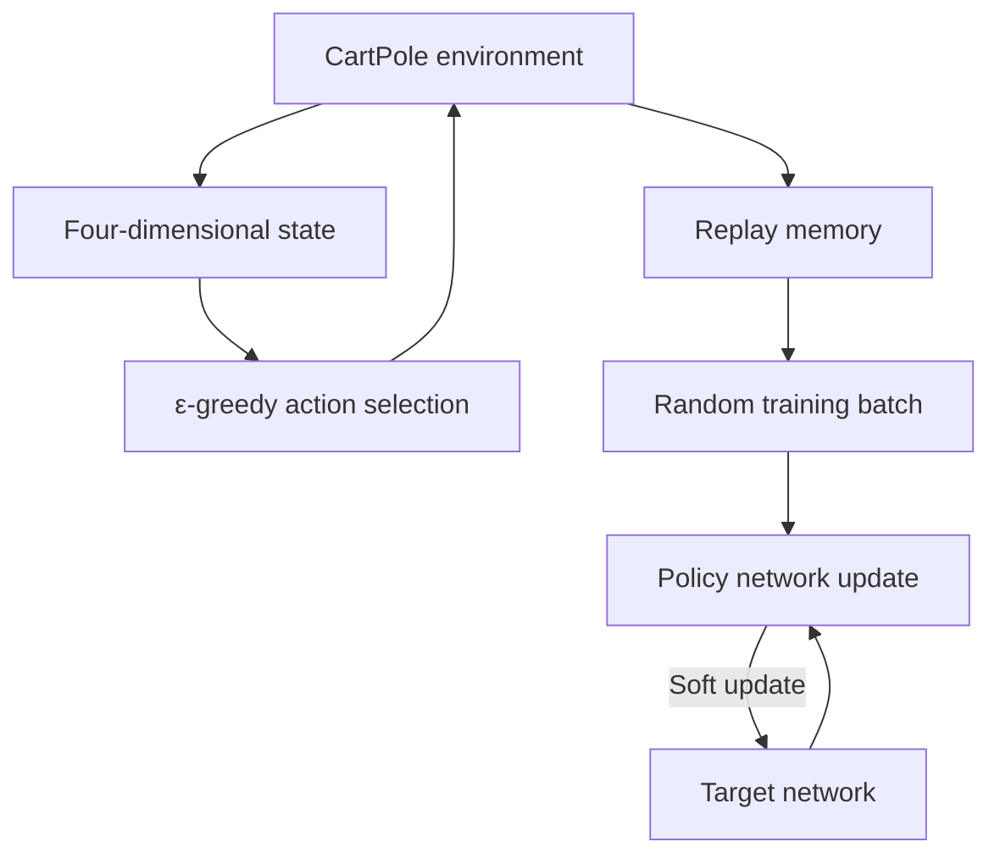

# Reinforcement Learning Lab · Gymnasium and DQN

[简体中文](README.md) | [English](README_EN.md)

Reinforcement-learning experiments connecting environment interaction with value learning. Gymnasium introduces states, actions, rewards and episodes, followed by an exploration of the PyTorch DQN training workflow for CartPole control.

**Stack:** Python · Gymnasium · PyTorch · NumPy · Matplotlib · Jupyter

## Project contents

- **Environment interaction**: random policies in CartPole and LunarLander, observing states, rewards, termination and truncation.
- **Space representations**: `Discrete` and `Box` examples for discrete actions and continuous observations.
- **DQN training structure**: policy/target networks, experience replay, ε-greedy action selection and target-value computation.
- **Training stabilisation**: Huber loss, gradient clipping and soft target-network updates.
- **Experiment analysis**: episode-duration plots and moving averages, with code and comments exploring architectures, exploration and reward design.

## CartPole DQN workflow



The network consumes CartPole's four-dimensional observation and outputs Q values for two discrete actions. Replay memory stores `state / action / next_state / reward` transitions. Training samples random batches and uses the target network to construct Bellman targets.

## Model and training configuration

| Component | Configuration |
| --- | --- |
| Environment | `CartPole-v1` |
| Q-network | Input → 128 → 128 → action count; ReLU |
| Replay memory | `deque` with capacity 10,000 |
| Batch size | 128 |
| Discount factor | 0.99 |
| Optimiser | AdamW, `lr=1e-4`, `amsgrad=True` |
| Loss | SmoothL1Loss / Huber loss |
| Target update | Soft update, `TAU=0.005` |
| Exploration | Custom linear decay with a floor of 0.05 |
| Device | CUDA when available, otherwise CPU |
| Plots | Episode duration and 100-episode moving average |

The notebook also retains experimental alternatives for a wider network, exponential exploration decay and additional reward penalties. These commented alternatives are distinguished from the active configuration.

## File guide

| File | Contents |
| --- | --- |
| `1.gym.ipynb` | Gymnasium API, random policies, CartPole/LunarLander and space examples |
| `2.reinforcement_q_learning.ipynb` | PyTorch DQN, replay memory, model, training loop and visualisation |
| `3.mindspore_rl_dqn.ipynb` | Extension instructions for porting DQN to MindSpore |
| Root-level experiment reports | Records and analysis in PDF / DOCX |
| `lab3-强化学习课件.pdf` | Course reinforcement-learning slides |

The MindSpore section is an extension assignment; the main DQN implementation uses PyTorch.

## Environment setup

Use a dedicated Python environment and install a device-compatible PyTorch build. For Jupyter and CartPole dependencies:

```bash
git clone https://github.com/VincentLucifer/AI-Lab3-ReinforcementLearning.git
cd AI-Lab3-ReinforcementLearning
python -m pip install notebook ipykernel numpy matplotlib "gymnasium[classic-control]"
jupyter notebook
```

`1.gym.ipynb` also includes `LunarLander-v3`, which needs additional Box2D dependencies:

```bash
python -m pip install "gymnasium[box2d]"
```

Human rendering requires a desktop display. Configure `render_mode` appropriately for server environments.

## Suggested reading order

1. Read `1.gym.ipynb` for `reset()`, `step()` and observation/action spaces.
2. Inspect `ReplayMemory` and `DQN` to connect the data flow with the Q-network.
3. Follow `select_action()`, `optimize_model()` and the main training loop.
4. Use plots and reports to examine how exploration, target networks and reward design affect learning.

## Technical focus

- **Separate sampling from learning** through replay memory and random training batches.
- **Assign distinct roles to policy and target networks** for current Q estimates and training targets.
- **Distinguish termination from truncation** in interaction and next-state handling.
- **Explore experimental factors individually**, including network capacity, exploration schedules and reward design.

## References and acknowledgements

The DQN notebook adapts the [PyTorch DQN Tutorial](https://pytorch.org/tutorials/intermediate/reinforcement_q_learning.html) for course experiments. Gymnasium provides the environment interface. Teaching materials and upstream code retain their respective usage terms.

## Related labs

[Lab 1 · Pacman Search](https://github.com/VincentLucifer/AI-Lab1-Pacman) · [Lab 2 · Deep Learning](https://github.com/VincentLucifer/AI-Lab2-DeepLearning)
